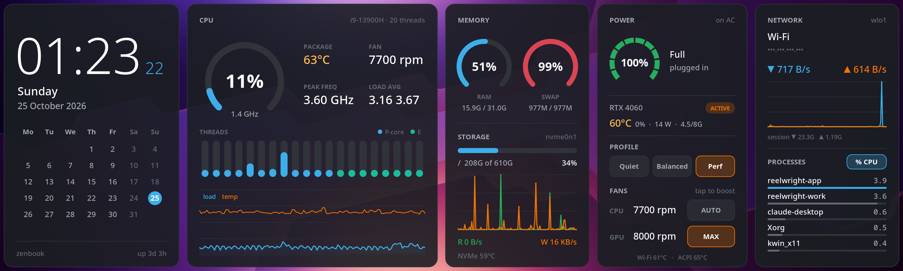

# zen-conky

A touch-enabled system dashboard for the **ASUS Zenbook Duo ScreenPad Plus**,
the 2880×864 second screen under the main display. Built for KDE Plasma on X11
with stock conky. Every pixel is drawn with Lua and cairo.



## Features

| Card | Shows | Touch |
|---|---|---|
| **Clock** | time, date, month calendar, host, uptime | |
| **CPU** | load gauge, package temperature, fan rpm, peak frequency, load average, per-thread bars (P-cores blue, E-cores cyan), load and temperature history | |
| **Memory** | RAM and swap gauges, root filesystem usage, disk read/write graph, NVMe temperature | |
| **Power** | battery, charge rate, NVIDIA dGPU state with temperature, load, power and VRAM | thermal profile **Quiet / Balanced / Performance**, CPU and GPU fan boost **AUTO / MAX** |
| **Network** | SSID, IP, down/up rates and graph, session totals, top 5 processes | sort processes by **CPU / RAM** |

- **Uses stock `conky-all` 1.24.** It needs no patched build. Touch reaches conky
  through `lua_mouse_hook` as ordinary left clicks.
- **Scales to any ultra-wide screen.** The layout is drawn on a 1440×432 logical
  canvas and scaled to fit, so it works at 2880×864 or any other ultra-wide mode.
- **Keeps the dGPU asleep when idle.** GPU readings come from NVML, and only while
  the GPU is already awake, so the dashboard never wakes the RTX and drains the battery.
- **Finds hardware by name.** Sensors are looked up by hwmon chip name, so they
  survive the hwmon renumbering that happens across reboots.
- **Has a privacy mode.** `ZEN_PRIVATE=1` hides the hostname, SSID and IP for
  screenshots and streaming.

## Quick start

```sh
sudo apt install conky-all x11-xserver-utils
git clone https://github.com/geniuskidkanyi/zen-concky.git ~/Tools/zen-conky
cd ~/Tools/zen-conky
./start.sh                  # run it on the ScreenPad now
./start.sh autostart        # start it at every login
sudo ./start.sh fan-access  # optional: enable the fan AUTO/MAX buttons
```

See **[INSTALL.md](INSTALL.md)** for the full guide: requirements, fan
permissions, autostart, configuration and troubleshooting.

## Commands

| Command | What it does |
|---|---|
| `./start.sh` | find the ScreenPad and start (or restart) the dashboard |
| `./start.sh stop` | stop the dashboard and the GPU helper |
| `./start.sh autostart` | add a KDE login entry (`~/.config/autostart/zen-conky.desktop`) |
| `./start.sh noautostart` | remove it |
| `sudo ./start.sh fan-access` | install the udev rule that allows fan boost without root |

## Project layout

```
zen.conf             conky config: window, transparency, Lua hooks
start.sh             launcher: detects the ScreenPad geometry, manages processes
bin/zen-gpu.py       NVML helper for NVIDIA temperature/load/power/VRAM
lua/main.lua         cards, layout (CARDS table), sampling, touch handling
lua/zen/draw.lua     cairo primitives: ring, bar, graph, text, card, arrow
lua/zen/sensors.lua  sysfs/procfs readers, fan and profile control
lua/zen/theme.lua    colours, fonts, opacity
```

## Customising

- **Colours and fonts:** edit `lua/zen/theme.lua`. Set `panel_alpha` above 0 to
  put a backdrop behind the whole strip.
- **Cards:** reorder, resize or remove them in the `CARDS` table at the bottom
  of `lua/main.lua`. Each card is one function that draws in its own local
  coordinates. To make something tappable, register it with
  `button(...)` or `hit(...)`.

## Hardware notes

Developed on a Zenbook Pro 14 Duo (UX8402VV: i9-13900H, RTX 4060) running
Debian with Plasma on X11.

- The ScreenPad is found automatically: it is the connected output whose
  preferred mode is at least 3:1.
- Fan boost writes `pwm1_enable` (CPU) and `pwm2_enable` (GPU) in the `asus`
  hwmon. `0` means full speed and `2` means automatic.
- The UX8402 firmware has no custom fan curves and no GPU temperature target,
  so the thermal profile and fan boost are the only controls available.
- Other Zenbook Duo models with a ScreenPad Plus should work. Cards hide
  sensors they can't find.

## Credits

The look was inspired by
[conky-nextgen](https://github.com/molnari811023/conky-nextgen) by István
Molnár. zen-conky is an independent implementation and shares no code with it.

Author: Muhammed Kanyi
